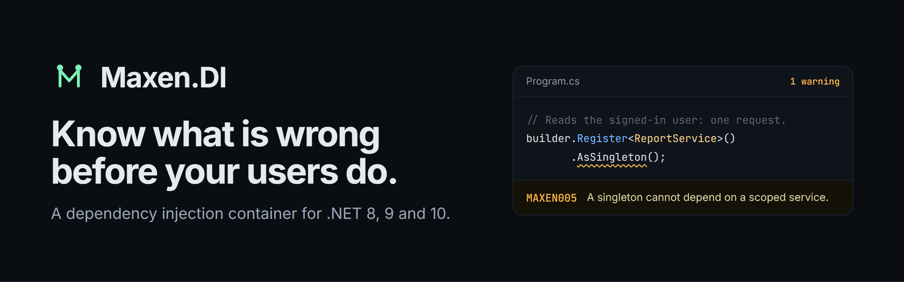
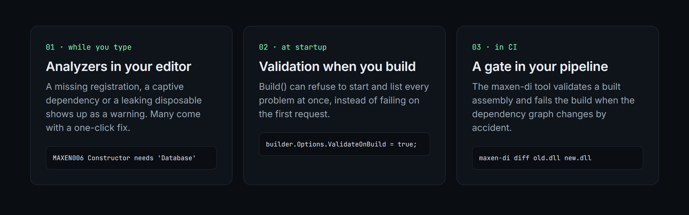

[](https://www.nuget.org/packages/Maxen.DI) [](https://github.com/pfimax/maxen.di/actions/workflows/ci.yml)  [](https://github.com/pfimax/maxen.di/blob/main/LICENSE)

[Documentation](https://pfimax.github.io/maxen.di/) · [Getting started](https://pfimax.github.io/maxen.di/docs/getting-started.html) · [API reference](https://pfimax.github.io/maxen.di/api/) · [Samples](https://github.com/pfimax/maxen.di/tree/main/samples) · [Changelog](https://github.com/pfimax/maxen.di/blob/main/CHANGELOG.md)

**A dependency injection container for .NET that tells you what is wrong before your users do.**

Most containers wait until a request is half-way through to say "I couldn't build that". Maxen.DI checks your wiring
while you type, again when the app starts, and once more in CI. Then it gets out of the way and resolves quickly.

- **Catch mistakes early.** A missing registration, a loop, a singleton holding on to a per-request service: analyzers
  flag them as you write the code, `Validate()` at startup, and a command line tool in your pipeline.
- **Works with what you have.** Runs behind `Microsoft.Extensions.DependencyInjection`, the Generic Host and
  ASP.NET Core, and passes Microsoft's own conformance tests, keyed services included.
- **No reflection when you don't want it.** A source generator writes registrations, decorators and interceptor proxies
  at compile time, so your app stays friendly to trimming and native AOT.
- **Open all the way down.** Lifetimes, middleware, registration sources, parameter resolvers, interceptors and
  observers are plain interfaces. The built-in features use the same ones.



## Quick start

```bash
dotnet add package Maxen.DI
```

```csharp
var builder = new ContainerBuilder();
builder.Register<IClock, SystemClock>().AsSingleton();
builder.Register<IGreeter, Greeter>().AsScoped();

// Open generics, and decorators that wrap a service without touching it
builder.Register(typeof(IRepo<>), typeof(Repo<>));
builder.Decorate<IGreeter, LoudGreeter>();

// Fail at startup, listing every problem, instead of on the first request
builder.Options.ValidateOnBuild = true;

await using var container = builder.Build();
await using var scope = container.CreateScope();
var greeter = scope.Resolve<IGreeter>();
```

Prefer attributes? Mark the class and let the source generator write the registration at compile time:

```csharp
[Service(ServiceLifetime.Singleton, ServiceType = typeof(IClock))]
public class SystemClock : IClock { }

builder.RegisterGeneratedServices();
```

Already on ASP.NET Core? Keep your `builder.Services` registrations and swap the container:

```csharp
builder.UseMaxenDI(c => c.Decorate<IGreeter, LoudGreeter>());
```

## What goes wrong, and where you hear about it

| Mistake | Where Maxen.DI tells you |
|---|---|
| A constructor needs a service nobody registered | `MAXEN006` while typing, `Validate()` at startup, `maxen-di validate` in CI |
| A singleton quietly captures a per-request service | `MAXEN004`/`MAXEN005` while typing, scope validation at run time |
| A disposable transient resolved from the root container leaks | `MAXEN007` while typing |
| A scoped service resolved from the root container | `MAXEN010` while typing, scope validation at run time |
| A decorator needs a service nobody registered | `Validate()` at startup, `maxen-di validate` in CI |
| `Lazy<T>` or `Func<T>` of a scoped service inside a singleton | `MAXEN009` while typing |
| A pull request changes the dependency graph by accident | `maxen-di diff` fails the build |
| "Why did it pick that implementation?" | `maxen-di explain`, `ResolutionTrace`, "did you mean" errors |

Five of the ten analyzer warnings come with a one-click fix. The [diagnostics reference](https://pfimax.github.io/maxen.di/docs/diagnostics.html)
explains each one.

## Packages

| Package | | Use it for |
|---|---|---|
| [Maxen.DI](https://www.nuget.org/packages/Maxen.DI) | [](https://www.nuget.org/packages/Maxen.DI) | The container. The source generator, analyzers and code fixes ship inside it. |
| [Maxen.DI.Extensions.DependencyInjection](https://www.nuget.org/packages/Maxen.DI.Extensions.DependencyInjection) | [](https://www.nuget.org/packages/Maxen.DI.Extensions.DependencyInjection) | Maxen.DI behind `IServiceCollection` and the Generic Host. |
| [Maxen.DI.Extensions.AspNetCore](https://www.nuget.org/packages/Maxen.DI.Extensions.AspNetCore) | [](https://www.nuget.org/packages/Maxen.DI.Extensions.AspNetCore) | `UseMaxenDI()` for web apps, request values and a diagnostics endpoint. |
| [Maxen.DI.Tool](https://www.nuget.org/packages/Maxen.DI.Tool) | [](https://www.nuget.org/packages/Maxen.DI.Tool) | The `maxen-di` command line tool for graphs, validation and diffs in CI. |

All packages target .NET 8, 9, 10 and 11.

## Features

| Area | What you get | Guide |
|---|---|---|
| Registration | Types, instances and factories; keys (Microsoft's `[FromKeyedServices]`, `[ServiceKey]` and `AnyKey` too); open generics; collections, `Lazy<T>` and `Func<T>`; values passed at resolve time; conditional registrations | [Registering services](https://pfimax.github.io/maxen.di/docs/registering.html) |
| Lifetimes | Transient, scoped and singleton, plus named scopes, pooled, per-thread and your own; ordered disposal; async initialization | [Lifetimes, scopes and disposal](https://pfimax.github.io/maxen.di/docs/lifetimes.html) |
| Decorators and interceptors | Decorators with priorities and open generics; interceptors with compile-time proxies | [Decorators and interception](https://pfimax.github.io/maxen.di/docs/decorators-and-interception.html) |
| Configuration | Modules, profiles, feature flags, options, assembly scanning, child containers | [Modules, profiles and options](https://pfimax.github.io/maxen.di/docs/configuration.html) |
| Validation and diagnostics | Whole-graph validation, Mermaid and DOT graphs, resolution traces, OpenTelemetry | [Validation and diagnostics](https://pfimax.github.io/maxen.di/docs/validation-and-diagnostics.html) |
| Source generator | `[Service]`, `[Decorator]` and `[Intercept]` turned into code; generated constructor calls; native AOT | [The source generator](https://pfimax.github.io/maxen.di/docs/source-generator.html) |
| ASP.NET Core and Generic Host | `UseMaxenDI`, request values, a diagnostics endpoint for readiness probes | [ASP.NET Core and the Generic Host](https://pfimax.github.io/maxen.di/docs/aspnetcore.html) |
| Command line tool | `graph`, `validate`, `diff`, `snapshot`, `explain` and `init` | [The command line tool](https://pfimax.github.io/maxen.di/docs/command-line-tool.html) |
| Extending | Your own lifetimes, middleware, registration sources, parameter resolvers and observers | [Extending Maxen.DI](https://pfimax.github.io/maxen.di/docs/extending.html) |

Moving from Microsoft DI or Autofac? The [migration guide](https://pfimax.github.io/maxen.di/docs/migrating.html) maps
the calls you know.

## Performance

BenchmarkDotNet runs on one machine (Core i5-11400F, .NET 10):

| Scenario | Maxen.DI | Microsoft | Autofac |
|---|---|---|---|
| Resolve an existing singleton | ~13 ns, 0 B | ~6 ns, 0 B | ~70 ns, 656 B |
| New scope and a three-level graph | ~115 ns, 232 B | ~85 ns, 360 B | ~1,230 ns, 4.8 KB |
| Same scoped service asked for 10 times | ~180-260 ns, 208 B | ~295 ns, 336 B | ~1,680 ns, 9.9 KB |
| Build a container and serve the first request | ~3.8 µs, 13 KB | ~2.2 µs, 8 KB | ~14.9 µs, 37 KB |
| Every registration of a service (three singletons) | ~16 ns, 0 B | ~8 ns, 0 B | ~415 ns, 1.2 KB |
| A keyed singleton | ~19 ns, 0 B | ~11 ns, 0 B | ~75 ns, 664 B |

Maxen.DI is not the fastest container for every kind of work: Microsoft's is about twice as quick for a single lookup
and somewhat quicker for a fresh scope and for starting up. Maxen.DI is quicker when a scoped service is asked for
repeatedly, and allocates less per scope. The extra time buys the checking and the extension points. The
[comparison](https://pfimax.github.io/maxen.di/docs/comparison.html) has the full picture and how to run the
benchmarks yourself.

## Contributing

Issues and pull requests are welcome. [CONTRIBUTING.md](https://github.com/pfimax/maxen.di/blob/main/CONTRIBUTING.md)
explains how to build, test and release, and [CHANGELOG.md](https://github.com/pfimax/maxen.di/blob/main/CHANGELOG.md)
lists what changed in each version.

## License

[MIT](https://github.com/pfimax/maxen.di/blob/main/LICENSE)
